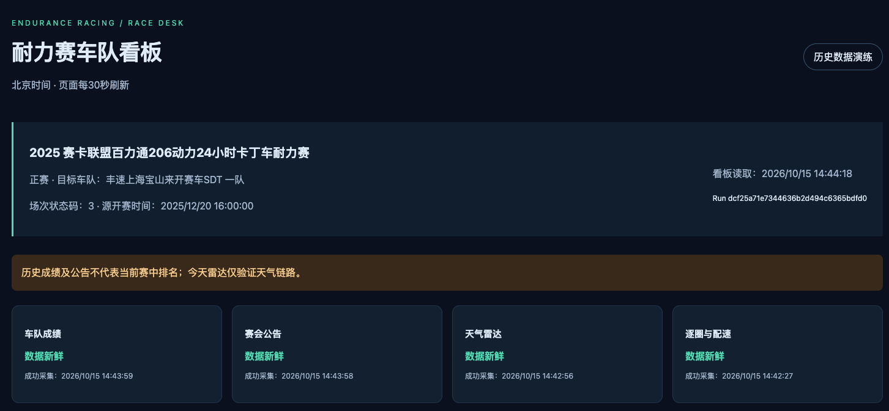
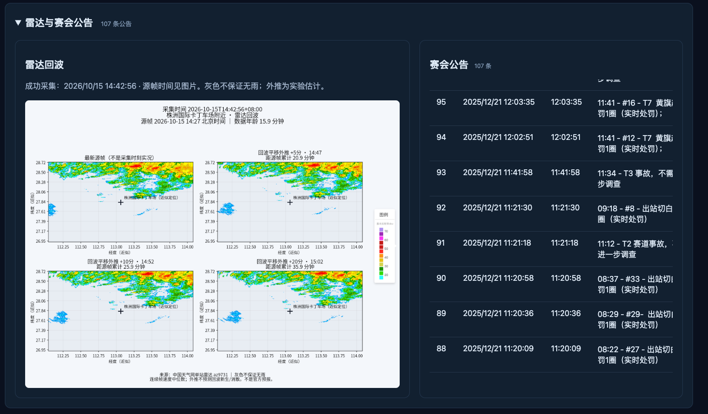
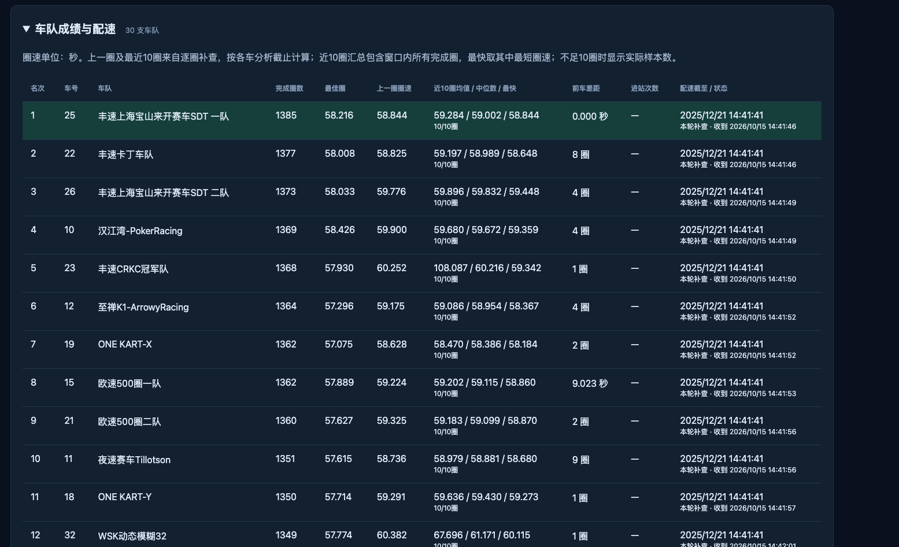
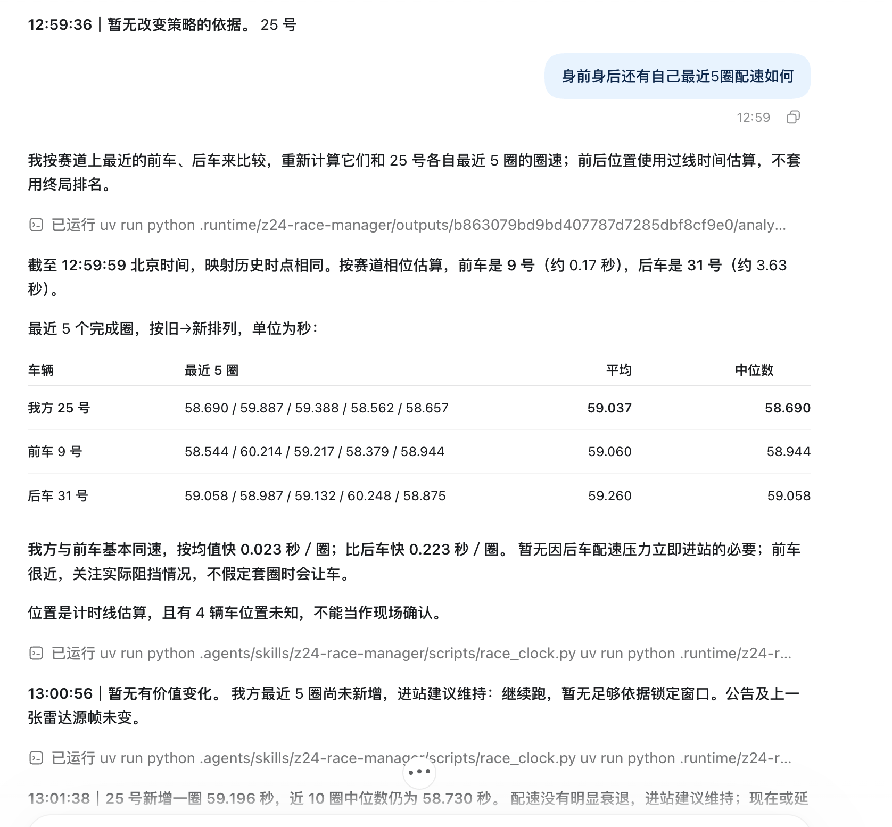
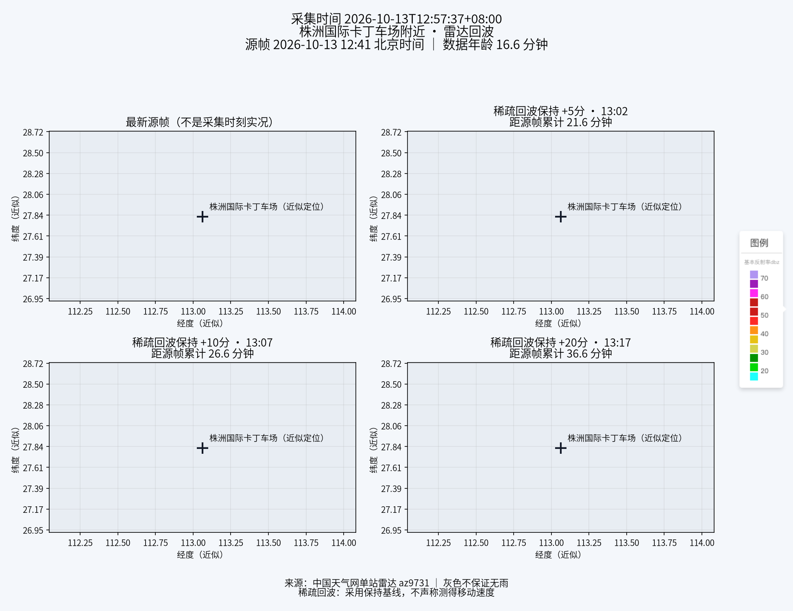
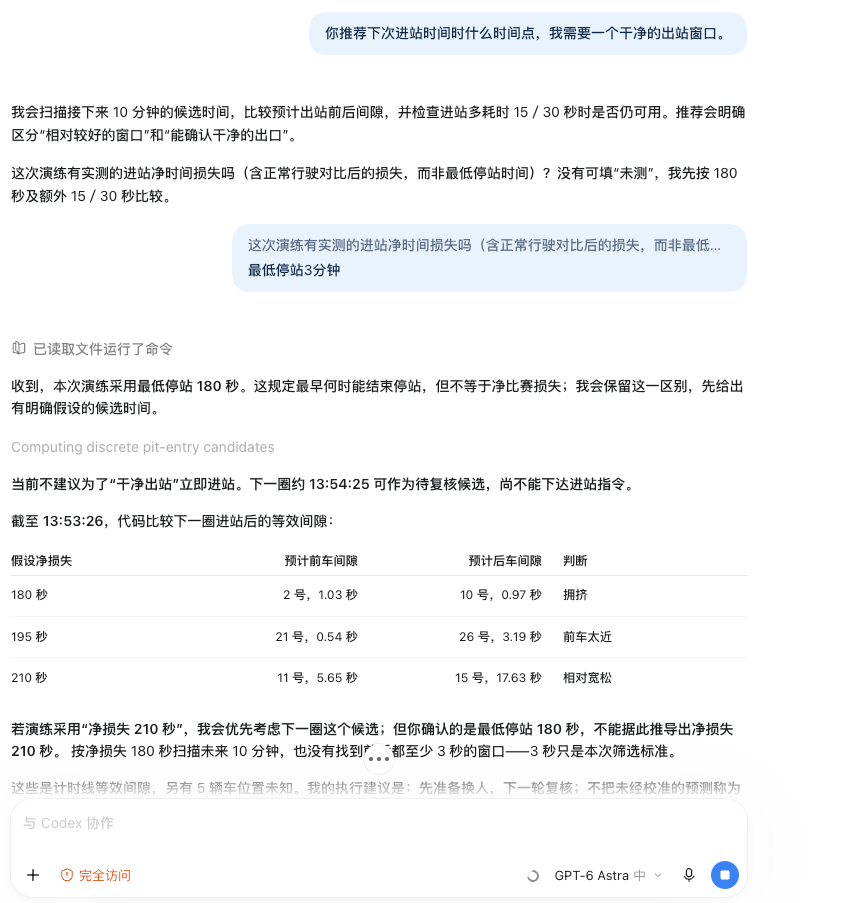
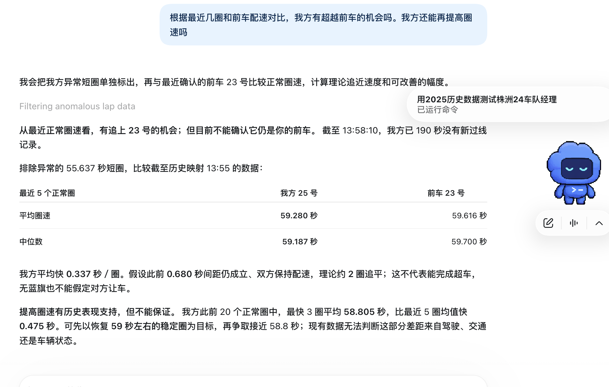

# 车队经理演示样例

本页截图来自用户提供的演练记录，展示株洲24小时耐力赛车队经理的交互与输出。赛事分析使用2025年历史数据；雷达图标注的是2026年10月13日或15日采集的数据，不代表2025年比赛当天的天气。截图中的时间、车号、圈速和建议仅用于说明输出形式，不作为当前赛况或实时指令。

## 静态数据看板

以下三张截图为2026年10月15日使用2025年历史赛事数据演练的看板。React直接读取Pydantic通用CSV与雷达PNG，页面每30秒刷新；天气采集每2分钟、成绩和公告每1分钟独立更新。页面刷新不会自动触发逐圈补查，配速按agent最近一次补查的分析截止时间计算。

### 赛事信息与采集状态

页面顶部显示赛事、目标车队、历史演练提示及四路采集状态。采集时间与分析截止时间分别显示，数据新鲜不代表历史终局成绩是当前赛中排名。

### 雷达与赛会公告

雷达和公告等高并排，整行支持折叠；公告在卡片内滚动，窄屏上下排列。截图左侧为当天雷达及实验外推，右侧为2025年赛会公告，两者不属于同一历史时点。回波外推不能换算赛道积水深度。

### 车队成绩与配速

成绩和配速合并到可折叠表格，突出目标车队，展示上一圈圈速、最近10个完成圈的均值／中位数／最快圈速及实际样本数。汇总包含该窗口所有完成圈，长圈可能显著抬高均值；最快值取同一窗口的最短圈速。秒差与圈差分开显示，缺少记录不补零。

## agent策略交互

以下四张为此前的策略交互样例。

## 前后车最近5圈配速

询问示例：“身前身后还有自己最近5圈配速如何？”

展示我方与赛道上相邻车辆的最近5圈、平均值及中位数，并解释配速差对策略的意义。前后车位置按计时线数据估算，需同时说明位置未知的车辆；不能直接用总排名代替赛道相对位置。

## 雷达回波与短时外推

展示采集时间、雷达源帧时间、数据年龄、场地近似位置和dBZ色标，以及未来5、10、20分钟的图像。

这张样例属于稀疏回波保持基线：灰色不保证无雨，也不表示已测得回波移动速度。采集时间和源帧时间需分开判断，不能将这张图用于推断历史赛事天气。

## 进站候选窗口与损失假设

询问示例：“你推荐下次进站时间什么时间点，我需要一个干净的出站窗口。”

展示180、195、210秒假设损失下的预计出站前后间隙，帮助比较候选窗口对额外耗时的敏感程度。最低停站180秒与相对正常行驶的净比赛损失是不同概念；图中的候选时刻依赖假设和位置估算，不等于已经确认的干净出站窗口。

## 追近机会与目标配速

询问示例：“根据最近几圈和前车配速对比，我方有超越前车的机会吗，我方还能再提高圈速吗？”

展示异常圈处理、正常圈配速比较、理论追近圈数和历史配速参考，同时指出过线记录是否陈旧。理论追平不等于能够超车；赛事没有蓝旗，不能假设被套圈车辆会让车。

